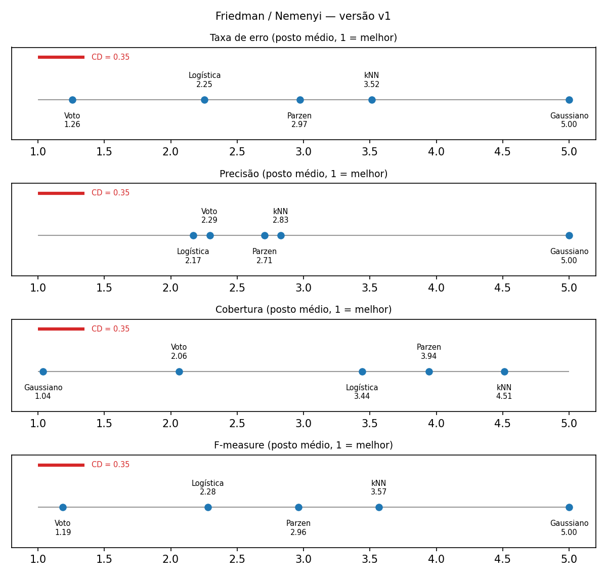
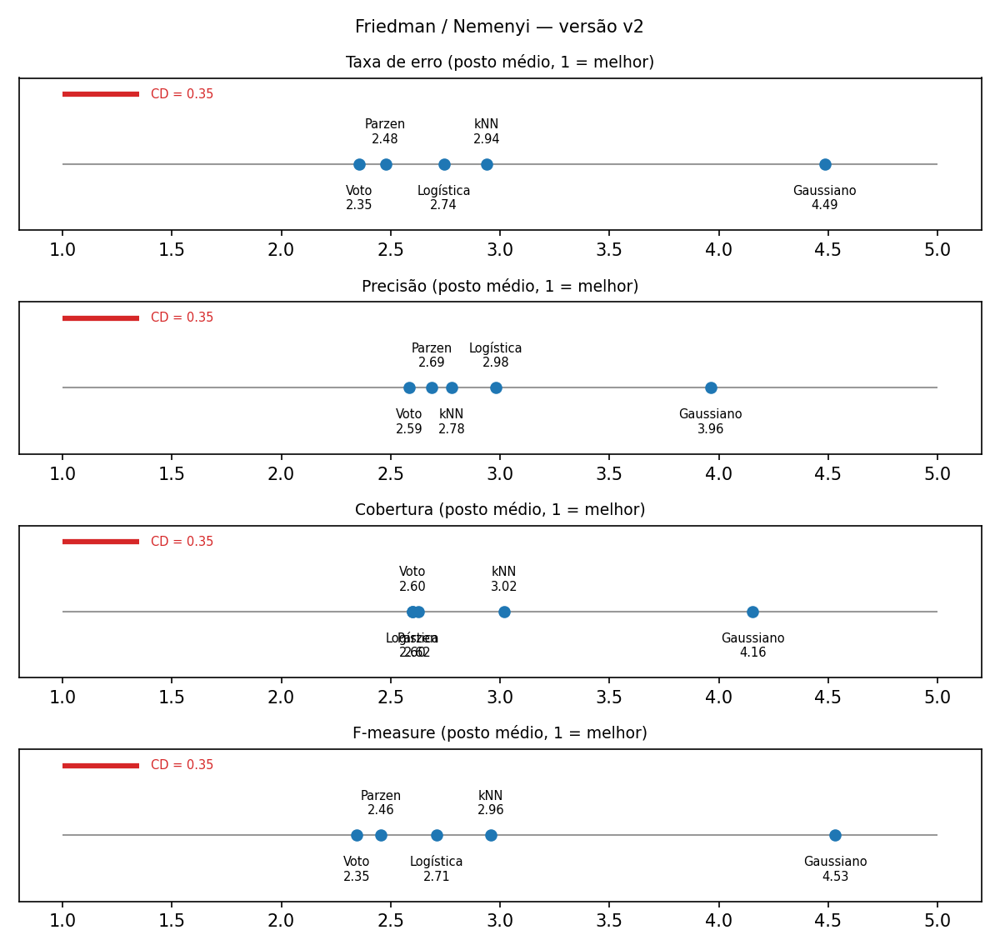

# Resultados da Questão 2

Gerado por `analisar.py` a partir de `resultados_cv_<versao>.csv` (validação cruzada estratificada 30 × 10-folds, 300 avaliações por classificador). Precisão, cobertura e F-measure são da classe positiva (minoritária): spam na v1, o cluster de 34 e-mails na v2.

## Versão 1 — rótulo original (spam / não-spam)

### b) Estimativa pontual e IC 95% (correção de Nadeau & Bengio)

| Classificador | Taxa de erro | Precisão | Cobertura | F-measure |
|---|---|---|---|---|
| Bayesiano gaussiano | 0.1708 [0.1607, 0.1808] | 0.7128 [0.6998, 0.7257] | 0.9506 [0.9406, 0.9606] | 0.8145 [0.8050, 0.8240] |
| Bayesiano k-vizinhos | 0.0860 [0.0773, 0.0946] | 0.9132 [0.8968, 0.9296] | 0.8649 [0.8456, 0.8842] | 0.8879 [0.8764, 0.8995] |
| Bayesiano Parzen | 0.0798 [0.0718, 0.0877] | 0.9146 [0.9012, 0.9280] | 0.8802 [0.8647, 0.8957] | 0.8968 [0.8864, 0.9073] |
| Regressão logística | 0.0725 [0.0649, 0.0801] | 0.9231 [0.9100, 0.9362] | 0.8905 [0.8761, 0.9050] | 0.9063 [0.8964, 0.9162] |
| Voto majoritário | 0.0641 [0.0564, 0.0717] | 0.9201 [0.9071, 0.9331] | 0.9175 [0.9046, 0.9304] | 0.9186 [0.9089, 0.9283] |

### c) Friedman e Nemenyi

| Métrica | χ² | p-valor | Rejeita H0? | CD | Postos médios (1 = melhor) |
|---|---|---|---|---|---|
| Taxa de erro | 957.2 | 6.68e-206 | sim | 0.352 | Voto majoritário 1.26, Regressão logística 2.25, Bayesiano Parzen 2.97, Bayesiano k-vizinhos 3.52, Bayesiano gaussiano 5.00 |
| Precisão | 636.8 | 1.71e-136 | sim | 0.352 | Regressão logística 2.17, Voto majoritário 2.29, Bayesiano Parzen 2.71, Bayesiano k-vizinhos 2.83, Bayesiano gaussiano 5.00 |
| Cobertura | 984.1 | 9.73e-212 | sim | 0.352 | Bayesiano gaussiano 1.04, Voto majoritário 2.06, Regressão logística 3.44, Bayesiano Parzen 3.94, Bayesiano k-vizinhos 4.51 |
| F-measure | 975.5 | 7.37e-210 | sim | 0.352 | Voto majoritário 1.19, Regressão logística 2.28, Bayesiano Parzen 2.96, Bayesiano k-vizinhos 3.57, Bayesiano gaussiano 5.00 |

Pares **sem** diferença significativa (Nemenyi, α = 0,05):

- Taxa de erro: nenhum (todos diferem)
- Precisão: Bayesiano k-vizinhos × Bayesiano Parzen; Regressão logística × Voto majoritário
- Cobertura: nenhum (todos diferem)
- F-measure: nenhum (todos diferem)

### Hiper-parâmetros escolhidos na CV interna (mais frequentes)

| Classificador | Configuração | Vezes escolhida (de 300) |
|---|---|---|
| Bayesiano gaussiano | reg=1e-05 | 117 |
| Bayesiano gaussiano | reg=0.0001 | 101 |
| Bayesiano gaussiano | reg=1e-06 | 82 |
| Bayesiano k-vizinhos | metrica=cityblock, k=1 | 120 |
| Bayesiano k-vizinhos | metrica=cityblock, k=5 | 106 |
| Bayesiano k-vizinhos | metrica=euclidean, k=1 | 32 |
| Bayesiano k-vizinhos | metrica=cityblock, k=7 | 29 |
| Bayesiano Parzen | h=0.5 | 173 |
| Bayesiano Parzen | h=0.6 | 123 |
| Bayesiano Parzen | h=0.7 | 4 |
| Regressão logística | C=30.0 | 107 |
| Regressão logística | C=100.0 | 63 |
| Regressão logística | C=10.0 | 61 |
| Regressão logística | C=1000.0 | 41 |

## Versão 2 — clusters do double k-means (K* = 2)

### b) Estimativa pontual e IC 95% (correção de Nadeau & Bengio)

| Classificador | Taxa de erro | Precisão | Cobertura | F-measure |
|---|---|---|---|---|
| Bayesiano gaussiano | 0.0036 [0.0019, 0.0054] | 0.7910 [0.6475, 0.9345] | 0.7486 [0.5949, 0.9023] | 0.7444 [0.6203, 0.8684] |
| Bayesiano k-vizinhos | 0.0008 [0.0000, 0.0016] | 0.9666 [0.9105, 1.0000] | 0.9378 [0.8463, 1.0000] | 0.9426 [0.8808, 1.0000] |
| Bayesiano Parzen | 0.0003 [0.0000, 0.0009] | 0.9748 [0.9260, 1.0000] | 0.9875 [0.9348, 1.0000] | 0.9772 [0.9324, 1.0000] |
| Regressão logística | 0.0006 [0.0000, 0.0013] | 0.9464 [0.8795, 1.0000] | 0.9906 [0.9417, 1.0000] | 0.9632 [0.9126, 1.0000] |
| Voto majoritário | 0.0002 [0.0000, 0.0007] | 0.9862 [0.9494, 1.0000] | 0.9906 [0.9417, 1.0000] | 0.9855 [0.9455, 1.0000] |

### c) Friedman e Nemenyi

| Métrica | χ² | p-valor | Rejeita H0? | CD | Postos médios (1 = melhor) |
|---|---|---|---|---|---|
| Taxa de erro | 617.8 | 2.17e-132 | sim | 0.352 | Voto majoritário 2.35, Bayesiano Parzen 2.48, Regressão logística 2.74, Bayesiano k-vizinhos 2.94, Bayesiano gaussiano 4.49 |
| Precisão | 349.5 | 2.21e-74 | sim | 0.352 | Voto majoritário 2.59, Bayesiano Parzen 2.69, Bayesiano k-vizinhos 2.78, Regressão logística 2.98, Bayesiano gaussiano 3.96 |
| Cobertura | 567.4 | 1.80e-121 | sim | 0.352 | Regressão logística 2.60, Voto majoritário 2.60, Bayesiano Parzen 2.62, Bayesiano k-vizinhos 3.02, Bayesiano gaussiano 4.16 |
| F-measure | 641.6 | 1.57e-137 | sim | 0.352 | Voto majoritário 2.35, Bayesiano Parzen 2.46, Regressão logística 2.71, Bayesiano k-vizinhos 2.96, Bayesiano gaussiano 4.53 |

Pares **sem** diferença significativa (Nemenyi, α = 0,05):

- Taxa de erro: Bayesiano k-vizinhos × Regressão logística; Bayesiano Parzen × Regressão logística; Bayesiano Parzen × Voto majoritário
- Precisão: Bayesiano k-vizinhos × Bayesiano Parzen; Bayesiano k-vizinhos × Regressão logística; Bayesiano k-vizinhos × Voto majoritário; Bayesiano Parzen × Regressão logística; Bayesiano Parzen × Voto majoritário
- Cobertura: Bayesiano Parzen × Regressão logística; Bayesiano Parzen × Voto majoritário; Regressão logística × Voto majoritário
- F-measure: Bayesiano k-vizinhos × Regressão logística; Bayesiano Parzen × Regressão logística; Bayesiano Parzen × Voto majoritário

### Hiper-parâmetros escolhidos na CV interna (mais frequentes)

| Classificador | Configuração | Vezes escolhida (de 300) |
|---|---|---|
| Bayesiano gaussiano | reg=1e-06 | 300 |
| Bayesiano k-vizinhos | metrica=euclidean, k=1 | 173 |
| Bayesiano k-vizinhos | metrica=euclidean, k=11 | 36 |
| Bayesiano k-vizinhos | metrica=cityblock, k=1 | 35 |
| Bayesiano k-vizinhos | metrica=euclidean, k=15 | 25 |
| Bayesiano Parzen | h=2.0 | 179 |
| Bayesiano Parzen | h=3.0 | 104 |
| Bayesiano Parzen | h=1.0 | 11 |
| Bayesiano Parzen | h=1.5 | 4 |
| Regressão logística | C=0.1 | 147 |
| Regressão logística | C=0.3 | 110 |
| Regressão logística | C=1.0 | 32 |
| Regressão logística | C=0.03 | 5 |
